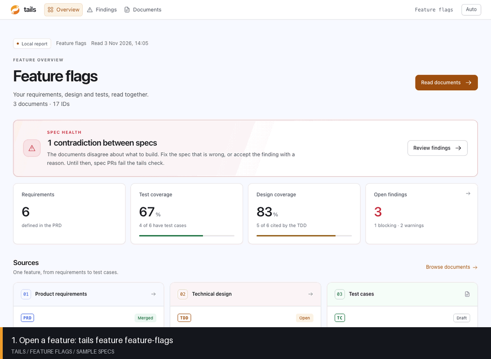

# Tails

**Keep a feature's requirements, design and tests in agreement.**

Tails reads the documents behind a feature and the pull requests that hold them.
It shows where they disagree and which requirements need a design or test case.
It runs on your computer and uses your GitHub login.



*The demo uses [sample feature-flag specs](cli/examples/feature-flags). The report comes from Tails itself.*

## How it works

1. **Add your links.** Give Tails the product requirements (PRD), technical design (TDD), and test case links.
   Each link can point to a GitHub pull request or Markdown file.
2. **Open the report.** Tails reads the documents together and opens a local page in your browser.
3. **Follow the evidence.** See which documents disagree, compare their text, and open the exact lines.

The report has three main pages:

| Page | What you can do |
| --- | --- |
| **Overview** | See the feature's spec health, requirement coverage, and source pull requests. |
| **Findings** | Filter conflicts and warnings. Read the evidence and the suggested next step. |
| **Documents** | Read each document. Follow requirement IDs into the design and test cases. |

Coverage means a document names a requirement. Tails does not run the tests.
You can also link a Linear ticket and implementation pull requests to the feature.
Prepare a conformance task for your agent and import its assessment to see requirement-level code
evidence, deviations, decisions, and outstanding manual checks. See the [conformance guide](cli/README.md#implementation-conformance).

## Install

You need [Node.js 20 or later](https://nodejs.org/en/download), [Git](https://git-scm.com/downloads),
and the [GitHub CLI](https://cli.github.com/).

Install the CLI from this repository:

```sh
git clone https://github.com/jpboliv/tails.git
cd tails/cli
npm ci
npm run build
npm install --global .
```

Sign in to GitHub if you have not already:

```sh
gh auth login
```

### Open your first feature

```sh
tails feature new
```

Enter a name and paste the document links when Tails asks.
Press Enter to skip an optional link. You need at least one document.
Tails saves the links and opens the report in your browser.

To read the latest documents again, use the saved feature name:

```sh
tails feature feature-flags
```

Run `tails feature` to list your saved features. Press Ctrl+C to stop the local server.

### Try the sample

From `tails/cli`, run:

```sh
tails report --repo examples/feature-flags --out "$HOME/tails-documentation/sample"
tails serve "$HOME/tails-documentation/sample"
```

Open the address that Tails prints. The sample needs no GitHub login.

## Where your files go

Tails saves feature links and reports in `~/tails-documentation`.
Use `--home <folder>` or `TAILS_HOME` to choose another folder for your features.
Tails reads your projects without changing them or posting to GitHub.

No `.env` file, database, API key or hosted service is needed. GitHub access comes from `gh`.

## First release scope

The CLI indexes specs, checks drift, compares spec revisions, builds local reports, and prepares
tasks for your agent. Imported conformance assessments connect requirements to reviewed code and
retain decisions and spec defects. Tails checks their GitHub code/spec revisions on refresh;
tracker context comes from the reviewing agent and its current revision remains unverified.
Tails does not calculate delivery progress or execute agents. Scope-conflict checks are word-based
and cover the documented table formats; a report with no findings is not proof that arbitrary prose agrees.

## More

- [Full guide](cli/README.md): feature files, commands, checks, and team skills.
- [Releases](docs/releases.md): versioning, publishing, installation, and recovery.
