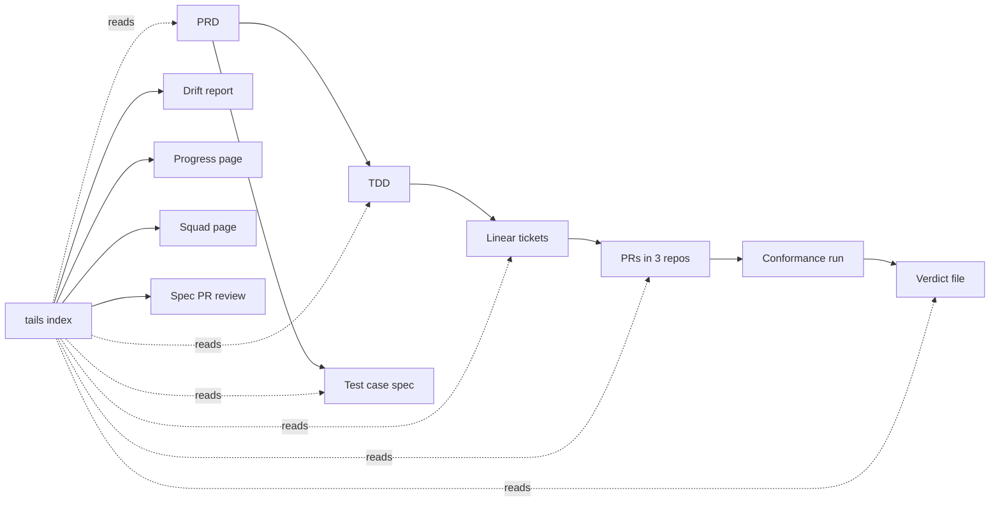

# tails v2 — PRD

> Planning reference: this document includes future delivery tracking and squad views.
> See the [release scope](../../README.md#first-release-scope) for what the first CLI release ships.

Owner: João Oliveira · Revision: 3 · Epic: none yet (Q-1) · Technical design: [tails v2 TDD](../tdds/tails-v2.md)

## Why and for whom

Tails is a standalone product. It tracks whether requirements stay aligned across documents and get
delivered across PRs. Teams select the skills that assess their work and can edit those instructions
to follow their own rules. Deemaze Skills is an integration, not Tails' destination.
This direction supersedes the plugin migration plan (decided by João Oliveira, 2026-11-02).

At Deemaze, product writes a PRD, then the engineers and tech lead write a TDD and QA writes a test
case spec. Agents (Cursor, Claude Code, Codex) build the TDD as many PRs across repositories. The
`spec-conformance` skill (deemaze/deemaze-skills#97) checks one PR against its ticket and TDD. Nothing
answers the questions that span documents and PRs:

- Does the TDD still say what the PRD says?
- Which requirements are delivered, which are partial, and which have no work yet?
- What shipped against the PRD, in product terms?

Today someone answers these by reading the documents side by side. A TDD can keep planning work
after the PRD has moved it into "Not doing", without either author's review catching the conflict.

Each squad has a product person, a tech lead and two engineers. Two designers float between squads.

| Who | What they need |
| --- | --- |
| Product person | To see what shipped against each PRD requirement, and to know when the TDD has moved away from the PRD. |
| Tech lead | To see drift between the PRD, TDD and test spec before a story starts, and each requirement's state with its evidence. |
| Engineer | To know which requirement IDs a ticket or PR delivers, and what each conformance run said about them. |
| Designer | To see, across squads, which journeys are being built and which are open. |
| QA | To see which test cases cover each PRD requirement, and which requirements have none. |
| Agent | A stable ID index to cite, and a file format to write conformance verdicts to. |
| Team adopting Tails | To reference its existing skills or edit defaults, while keeping its own patterns and assessment rules. |

**Success check:** on the private pilot, tails reports a known scope conflict without anyone pointing
at it, and every requirement in the selected pilot scope shows a state that links to its
source · baseline: done by hand, no tool · target: both, at the end of the pilot · measured by: the
pilot's drift report and progress page · owner: João Oliveira · check on: end of slice S3 (TDD §9).

**Pilot:** João Oliveira is the only pilot user and the owner for now. He shows it to pjpires later
for feedback (decided by João Oliveira, 2026-10-29).

Further checks, each with an owner:

| ID | Check | Owner |
| --- | --- | --- |
| SC-1 | Every ID in the pilot PRD, TDD and test spec is indexed. Duplicates and dangling references are listed. | João Oliveira |
| SC-2 | The drift report flags the known scope conflict, and no more than Q-6 false findings on the private pilot set. | João Oliveira |
| SC-3 | The product person reads what shipped per PRD requirement without opening a PR. | João Oliveira, for the pilot |
| SC-4 | Tails makes no paid model call. Model work runs in the agents and CI the team already pays for. | João Oliveira |

## Scope

**In:** a standalone CLI that indexes the IDs in the spec repository, links them across the PRD, TDD, test spec,
Linear tickets and PRs, reports drift, and reads conformance verdicts. CI runs it and generates a
static page: progress per requirement, a page per squad, and a review report on each spec PR. The
repository is the source of truth. Anyone with access to the relevant repositories sees the page,
through GitHub's own repository access (decided by João Oliveira, 2026-10-29). Pilot repositories
and client validation data are maintained outside Tails. Repository tests use synthetic specs.
Projects select skills for spec review, PR review, and conformance. Tails supplies editable defaults
and accepts references to existing skill libraries. An agent executes the selected instructions.
Tails defines the result contracts and keeps assessment rules separate from its tracking engine.

**Not doing:**

| Item | Reason |
| --- | --- |
| Public pages, or a sign-in of tails' own | The page inherits GitHub repository access (decided by João Oliveira, 2026-10-29). |
| A database, a server or hosting | The repository and CI hold everything. Each run regenerates the output. |
| Paid model calls from tails | Model work runs in the agents and CI already in use. Tails reads what they write. |
| A fixed, Tails-only method for checking code against its spec | The project's selected conformance skill does this. Tails uses its results through a common contract. |
| Writing or editing specs | Authors and their agents write specs. Tails reports on them. |
| Replacing code review or QA | Tails shows evidence. Humans and checks decide. |
| The v1 reviewer app | Kept in a private archive; not part of the CLI release. |
| A production state | Deferred until a release tag or deploy signal exists to read (decided by João Oliveira, 2026-10-29). |
| Broad rollout beyond the initial pilot | After the pilot. Skill selection itself is team-independent. |
| Moving Tails into deemaze-skills | Tails stays standalone. Users can reference that library or another one. |

## Flow and acceptance criteria

### Journey 1 — Index the specs

#### FR-1 — Find any requirement by its ID

- **FR-1.1** Given the spec repository at a commit, when tails indexes it, then every ID it defines
  (FR-n.m, INV-n, Dn, Sn, TC-nn, Q-n, and matrix IDs such as BK-API-nn) is listed with its document,
  section and line.
- **FR-1.2** Given an ID defined twice in one document, when tails indexes it, then the run fails and
  names both places.
- **FR-1.3** Given a document that cites an ID nobody defines, when tails indexes it, then the
  citation is listed as dangling, with its place.
- **FR-1.4** Given an ID that existed at the last indexed commit, when it disappears or its text
  changes, then the index records the change against that ID. IDs are never renumbered or reused.

#### FR-2 — Follow a requirement across documents and work

- **FR-2.1** Given a test case with a `Covers:` line, when tails indexes it, then the test case links
  to each PRD criterion it names.
- **FR-2.2** Given a TDD matrix row whose source cites a PRD criterion, when tails indexes it, then the
  row links to that criterion. The current convention uses a `PRD` column (TDD D6).
  Adoption in Deemaze's templates is an integration task.
- **FR-2.3** Given a Linear ticket that lists requirement IDs, when tails reads it, then the ticket
  links to them.
- **FR-2.4** Given a PR that links its ticket, when tails reads it, then the PR links to the ticket's
  IDs.

### Journey 2 — Catch drift between the PRD and the TDD

#### FR-3 — See where the documents disagree

- **FR-3.1** Given a PRD criterion that no TDD row and no test case links to, when tails reports
  drift, then the criterion is listed as uncovered.
- **FR-3.2** Given a PRD "Not doing" item that a TDD decision, invariant or matrix row still covers,
  when tails reports drift, then it is listed as a scope conflict, citing both. The synthetic catalog
  fixture tests this with archive migration excluded by the PRD but planned by the TDD.
- **FR-3.3** Given a PRD changed after its TDD's last change, when tails reports drift, then the report
  lists the PRD IDs that changed since then.
- **FR-3.4** Given a finding that a person has reviewed, when they record it as accepted with a
  reason, then later reports show it as accepted, not open.

### Journey 3 — See progress per requirement

#### FR-4 — Know each requirement's state

- **FR-4.1** Given conformance verdicts for a requirement's PRs, when tails builds the progress page,
  then the requirement shows one conformance mark, and that mark links to the verdict, PR and spec
  commit it came from.
- **FR-4.2** Given a ticket that lists a requirement and has no PR, when tails builds the page, then
  the requirement shows as planned.
- **FR-4.3** Given a PRD criterion linked to TDD rows, when the product person opens it, then they see
  its state rolled up from those rows, in PRD terms.
- **FR-4.4** Given a verdict older than the PR's latest commit, when tails builds the page, then the
  state is marked stale.
- **FR-4.5** Given a requirement with an open delivering PR, when tails builds the page, then the
  requirement shows as in progress.
- **FR-4.6** Given a requirement whose delivering PRs are all merged and reachable from `develop` (the
  QA environment), when tails builds the page, then it shows as in QA. Reachable from `main`
  (staging), it shows as in staging.
- **FR-4.7** Given a requirement delivered by several PRs, when only some of them reach a branch, then
  the requirement stays at the earlier state. It is in a state only when all its delivering PRs reach it.

FR-4.5 to FR-4.7 are decided by João Oliveira, 2026-10-29.

### Journey 4 — Follow a squad

#### FR-5 — One page per squad

- **FR-5.1** Given a squad and its epics, when tails builds the squad page, then it lists each epic's
  documents, requirement progress, open drift and open questions.
- **FR-5.2** Given the two designers, when they open the squads index, then they see every squad's
  journeys and their state on one page.

### Journey 5 — Review a spec change

#### FR-6 — A report on every spec PR

- **FR-6.1** Given a PR to the spec repository, when CI runs tails, then the PR gets a report of IDs
  added, changed and removed, and of drift the PR adds or resolves.
- **FR-6.2** Given a PR that renumbers or reuses an ID, when CI runs tails, then the check fails.
- **FR-6.3** Given a PR that adds open questions, when CI runs tails, then the report lists them with
  their owners.

### Journey 6 — Use the team's skills and rules

#### FR-7 — Choose and customize the assessment method

- **FR-7.1** Given a project with no skill choices, when a user prepares a task, then Tails selects
  its bundled default for `spec-review`, `pr-review`, or `conformance`.
- **FR-7.2** Given an explicit file reference in `.tails.yml`, when a user prepares a task, then
  Tails uses that skill instead of the project-local and bundled defaults. Relative paths start
  at the project root.
- **FR-7.3** Given a skill path and revision in a local Git checkout, when Tails prepares a task,
  then it reads the entry at that revision and records the resolved commit. Supporting references
  must use that commit too.
- **FR-7.4** Given a user who wants project-specific rules, when they initialize a default, then
  Tails creates `.tails/skills/<role>/SKILL.md` for editing. An existing file or explicit selection
  is never overwritten. Later tasks select the edited file unless configuration selects another.
- **FR-7.5** Given a selected skill and a task, when Tails prepares the task, then the user's agent
  receives the selected instructions, original resource location, and applicable output contract.
  Preparation does not execute an assessment. A missing selected skill produces an error.
- **FR-7.6** Given a prepared task, when a user inspects its source record, then they can identify
  the selected role, source path, selection reason, entry-file digest, and Git commit when present.
  This record does not claim to snapshot local supporting files or the project.
- **FR-7.7** Given a custom skill, when the agent assesses the work, then it follows that skill's
  rules without merging the bundled method. Spec findings use `tails.drift/1`, conformance uses
  `tails.verdict/1`, and a PR review uses Markdown.

The first slice supports file references, local Git checkouts, editable defaults, and agent handoffs.
Direct agent runners, remote skill downloads, and automatic result collection are later work.
Custom skills do not automatically change the ID syntax that the indexer supports.

## Open questions

Assumptions are marked. Everything above them is stated by João or read from the Deemaze documents.
IDs are not reused: Q-2 (pilot), Q-3 (PRD column) and Q-5 (who sees the page) were answered and moved
into the sections above.

| ID | Question or assumption | Owner | Blocks | Next check |
| --- | --- | --- | --- | --- |
| Q-1 | Where does tails v2 work get tracked: a Linear project, or GitHub issues in jpboliv/tails? | João Oliveira | — | Before S1 |
| Q-4 | Assumption (medium confidence): tickets list their requirement IDs and PRs link their ticket, as #97 expects. | Tech lead | FR-2.3, FR-2.4 | Read 3 pilot tickets |
| Q-6 | How many false drift findings are acceptable on the pilot set? | João Oliveira | SC-2 | After S2 |
| Q-7 | Where is squad membership recorded: a file in the spec repository, Linear teams, or GitHub teams? | João Oliveira | FR-5 | Before S4 |
| Q-8 | Assumption (low confidence): product wants state per PRD criterion, not per TDD row. | Product person | FR-4.3 | Pilot review |
| Q-9 | Should e2e results count toward a requirement's state once QA moves to e2e? | QA, tech lead | FR-4.1 | After S3 |
| Q-10 | Which existing coding agent needs the first direct runner integration? | João Oliveira | Agent execution after FR-7.5 | After handoff trials |
