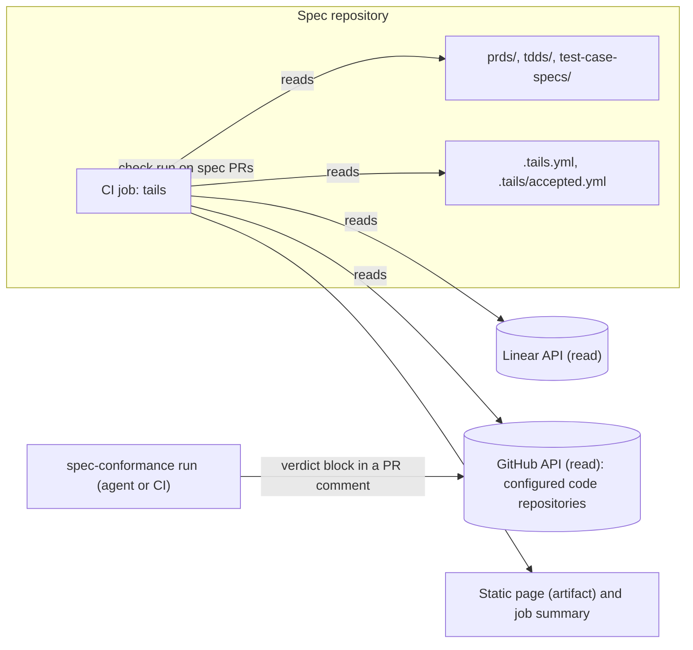

# Technical Design — tails v2

> Planning reference: S3 delivery tracking and S4 squad views are not in the first release.
> See the [release scope](../../README.md#first-release-scope) for the implemented CLI surface.

## 1. Summary

Tails v2 is a standalone CLI with project-selected agent skills. It indexes the requirement IDs in a spec repository and links them across
the PRD, TDD, test case spec, Linear tickets and PRs. It reports drift between those documents and
reads the verdicts that conformance checks write. CI runs it and generates a static page: progress per
requirement, a page per squad, and a review report on each spec PR. The repository is the source of
truth. Tails has no database, no server and no model calls. V1 is the indexer and the drift report,
validated on private pilot documents held outside this repository.
Teams can reference existing skill files or Git revisions, or edit bundled defaults.
The initial skill integration prepares instructions for the user's agent. It does not run a model.

## 2. Context and scope

Requirements come from the [tails v2 PRD](../prds/tails-v2.md). Repository tests use synthetic PRDs,
TDDs, matrices and test case specs. Integration references are
deemaze/deemaze-skills#97 (`spec-conformance`), #90 (TDD template) and #92
(`requirements-analysis`).

The design delivers:

- An index of every ID in the spec repository, with its place and its links.
- A drift report between the PRD, TDD and test spec.
- A verdict-file contract that `spec-conformance`, or any other checker, can write.
- A state per requirement, built from tickets, PRs and verdicts.
- A page per squad, and a review report on each spec PR.
- Project-selected skills and agent handoffs with source records and result contracts (§4.4.9).

The design excludes:

- A fixed code-assessment method. The selected conformance skill owns that method.
- Any model call. Agents that write verdicts or drift findings run in tools the team already uses.
- Hosting, sign-in and storage.
- The v1 reviewer app. It is kept in a private archive and is not part of the CLI release.

## 3. Quality requirements

| Quality | Requirement |
| --- | --- |
| Determinism | The same inputs give the same output, byte for byte (INV-3). |
| Traceability | Every state and finding links to the line, commit or URL it came from (INV-5). |
| Cost | No paid API call. A run fits in the free GitHub Actions minutes of one CI job. |
| Speed | A full run on the private pilot takes under 2 minutes in CI. Assumption: around 50 documents and 200 PRs. |
| Strictness | Malformed IDs and unknown verdict versions fail the run with a message. They are never guessed (INV-7, INV-8). |
| Replaceability | Skills own assessment instructions. Tails owns the result contracts, index, and reports. Each project can replace a skill without changing the indexer. |

## 4. Architecture

### 4.1 System boundaries



Report commands write outputs and the CI check summary (INV-1).
`skills init` explicitly creates a project-local default. `skills prepare` writes an agent task directory.

### 4.2 Components

| Component | Responsibility | Depends on |
| --- | --- | --- |
| `parse` | Reads markdown and finds ID definitions and citations (§4.4.1). | Markdown parser |
| `index` | Builds `index.json` from the parsed documents. Fails on duplicates and malformed IDs. | `parse` |
| `link` | Adds links from documents, tickets, PRs and verdicts (§4.4.2). | `index`, `sources` |
| `sources` | Fetches Linear tickets, GitHub PRs, PR comments and branch reachability, read-only. | Tokens in CI secrets |
| `verdicts` | Reads verdict files through adapters (§4.4.3). | `sources` |
| `drift` | Runs the drift rules and applies accepted findings (§4.4.4). | `index`, `link` |
| `progress` | Derives the state of each requirement (§4.4.5). | `link`, `verdicts` |
| `site` | Renders the progress, squad and document pages (§4.4.6). | `progress`, `drift` |
| `review` | Compares the index and drift at a spec PR's base and head (§4.4.7). | `index`, `drift` |
| `skills` | Selects opaque skill instructions, initializes editable defaults, and prepares an agent task (§4.4.9). | `config`, local files, Git, result schemas |

### 4.3 Data and state

Tails keeps no state between runs (INV-3). Each run rebuilds everything from its inputs:

| Input | Where it lives | Written by |
| --- | --- | --- |
| Specs | `prds/`, `tdds/`, `test-case-specs/` in the spec repository | Product, tech leads, engineers, QA |
| Config | `.tails.yml` in the spec repository: document globs, code repositories, Linear team, squads, drift term aliases, environment branches (`develop`: QA, `main`: staging) | Tech lead |
| Accepted findings | `.tails/accepted.yml` in the spec repository | Whoever accepts the finding, in a PR |
| Tickets | Linear | Tech lead, engineers |
| PRs and verdicts | GitHub, in the code repositories | Agents, engineers |
| Skill choices | `skills` in `.tails.yml` | Project maintainers |
| Skill instructions | Referenced files or Git revisions, `.tails/skills/<role>/SKILL.md`, or bundled defaults | Teams and skill authors |

| Output | Form |
| --- | --- |
| `index.json` | Every ID and link. A CI artifact. |
| `drift.json`, `drift.md` | Findings with citations. |
| `progress.json` | One state per requirement. |
| `site/` | Static HTML. A CI artifact of the spec repository (D7). |
| Job summary | `drift.md`, and on spec PRs the review report. |
| Agent task | `prompt.md`, `skill.md`, `source.json`, and `result.schema.json` when applicable |

### 4.4 Interfaces and contracts (required contract)

#### 4.4.1 ID indexing (required contract)

An ID is defined once and cited anywhere. Tails reads these definition positions, exercised by
synthetic fixtures and aligned with the #92 template:

| Family | Example | Defined where | Key |
| --- | --- | --- | --- |
| PRD criterion | `FR-4`, `FR-4.2` | `#### FR-n —` heading, `**FR-n.m**` bullet | `<doc>#FR-4.2` |
| Invariant | `INV-14` | First cell of the Invariants table | `<doc>#INV-14` |
| Decision | `D9` | First cell of the Decisions table, before the title (`D9 Management`) | `<doc>#D9` |
| Slice | `S3` | First cell of the Delivery table | `<doc>#S3` |
| Matrix row | `BK-API-42` | First cell of a matrix table | `BK-API-42` (global) |
| Test case | `TC-16` | `### TC-nn —` heading | `<doc>#TC-16` |
| Open question | `Q-3` | First cell of the Open questions table | `<doc>#Q-3` |
| Success check | `SC-2` | First cell of the success table | `<doc>#SC-2` |

- A matrix prefix is `<EPIC>-<AREA>`, such as `BK-API`, `BK-WEB` and `BK-USE`. It is unique across the
  repository, so tickets and PRs can cite matrix IDs bare (D5).
- Each index entry has `key`, `id`, `family`, `doc`, `section`, `line`, `text` and `text_hash`.
- A document maps to its epic through its `Epic:` header link, or the first Linear link in its §2.
  `.tails.yml` can override the mapping. A design ticket can differ from its epic: for example,
  `CAT-2` can belong to epic `CAT-1`.

#### 4.4.2 Linking (required contract)

| Link | From | To | Read from |
| --- | --- | --- | --- |
| `covers` | Test case | PRD criterion | The `Covers:` line |
| `sources` | Matrix row | PRD criterion or TDD section | The matrix `PRD` and `Source` columns (D6) |
| `cites` | Any document | Any ID | An ID-shaped token outside a definition position |
| `plans` | Linear ticket | IDs | The ticket description: the IDs it delivers |
| `delivers` | PR | Ticket | A Linear link or issue key such as `ACME-1` in the PR title or body |
| `checks` | Verdict | ID | Each verdict result |

Every page shows an ID's links both ways. Each ID has a stable anchor: `site/<doc>.html#<ID>`.

#### 4.4.3 Verdict file (required contract)

One file per conformance run on one PR head. Schema `tails.verdict/1`, in JSON:

```json
{
  "schema": "tails.verdict/1",
  "checker": { "name": "spec-conformance", "version": "0.1.0" },
  "pr": { "repo": "example/catalog-api", "number": 1, "head_sha": "<40 hex>" },
  "ticket": "CAT-2",
  "spec": { "repo": "example/catalog-specs", "commit": "<40 hex>" },
  "overall": "conforms | does_not_conform | cannot_check",
  "results": [
    {
      "id": "BK-API-14",
      "verdict": "met | missing | deviates | not_checkable | blocked",
      "evidence": [{ "spec": "tdds/CAT-2-catalog.md#L33", "code": "src/catalog/lookup.ts:12" }],
      "note": "text"
    }
  ],
  "changes": [
    { "kind": "incidental | addition | early_work", "paths": ["path"], "ids": ["BK-API-40"], "note": "text" }
  ],
  "decisions": [
    { "id": "D9", "ids": ["BK-API-42"], "spec_says": "text", "pr_does": "text", "who_decides": "tech lead" }
  ]
}
```

The values follow #97's report one to one:

| #97 report | Verdict file | PRD term |
| --- | --- | --- |
| ✅ Met | `met` | met |
| ❌ Missing | `missing` | missing |
| ⚠️ Deviates | `deviates`, with a `decisions` entry | partial, when the PR does part of it |
| 🔍 Not checkable from the diff | `not_checkable` | — |
| ⏸ Blocked | `blocked` | — |
| Diff sweep: Addition | `changes[].kind = addition` | unrequested change |
| Diff sweep: Early work | `changes[].kind = early_work`, with the later `ids` | — |
| Diff sweep: Incidental | `changes[].kind = incidental` | — |
| ✅ Conforms / ⚠️ Does not conform / ⛔ Cannot check | `overall` | — |

`partial` is not a per-PR verdict. It is a requirement state that tails derives when several PRs
deliver one requirement (§4.4.5).

**Transport.** Readers are adapters (D3):

- `comment`: a fenced `json` block after `<!-- tails:verdict v1 -->` in a PR comment. #97 already
  produces a markdown report, so it adds the block at the end. The latest block per `head_sha` wins.
- `file`: a path, for local runs and CI artifacts.

If a skill library publishes another machine format, Tails can add an adapter that maps it to
`tails.verdict/1`. Deemaze's format is one integration. Product work does not wait for its release.

#### 4.4.4 Drift report (required contract)

Each finding has `rule`, `ids`, `citations` (doc and line on both sides), `fingerprint` (rule plus
sorted keys, with each document named by its group and kind so a renamed file keeps it) and
`status` (`open` or `accepted`).

| Rule | Finds | PRD |
| --- | --- | --- |
| DR-1 Uncovered | A PRD criterion with no `sources` link from a matrix row and no `covers` link from a test case. | FR-3.1 |
| DR-2 Scope conflict | A PRD "Not doing" item whose terms appear in a TDD decision, invariant, matrix row or risk. | FR-3.2 |
| DR-3 PRD newer | PRD IDs whose `text_hash` changed in commits after the TDD's last commit. | FR-3.3 |
| DR-4 Dangling | A citation of an ID that no document defines. | FR-1.3 |
| DR-5 Orphan row | A matrix row with no PRD criterion in its `PRD` column. Warning until D6 is adopted. | FR-2.2 |
| DR-6 Test spec gap | A test case covering an ID the PRD does not define. | FR-2.1 |

DR-2 terms are the item's words that are not on a stop list, plus aliases from `.tails.yml`. The
synthetic catalog fixture must produce this finding, and its test asserts it:

```
DR-2 Scope conflict
  PRD  prds/CAT-1-catalog.md:13  Not doing: "Archive migration"
  TDD  tdds/CAT-2-catalog.md     D9, INV-14, BK-API-42, BK-API-44, BK-API-45, §7 risk "Archive records contain duplicates"
```

A person accepts a finding by adding its fingerprint, a reason, their name and a date to
`.tails/accepted.yml` in a PR. If the cited text changes, the fingerprint no longer matches and the
finding opens again.

An agent may write extra findings, such as semantic drift that terms cannot find, as a
`tails.drift/1` file with the same fields. Tails merges them and labels their source. Tails never
calls the model itself.

#### 4.4.5 Progress model (required contract)

Each matrix row has a delivery state and a conformance mark. Its delivering PRs are the PRs that link
a ticket planning the row, or cite the row. Closed, unmerged PRs do not count.

**Delivery state** comes from branch reach. At Deemaze, `develop` is the QA environment and `main` is
staging, and later production. A PR reaches a branch when its merge commit is reachable from that
branch. The row takes the first state that every delivering PR has reached (INV-10):

| State | Rule |
| --- | --- |
| `in_staging` | Every delivering PR is merged and reachable from `main`. |
| `in_qa` | Every delivering PR is merged and reachable from `develop`. |
| `in_progress` | At least one delivering PR exists, and some are open or not yet in `develop`. |
| `planned` | A ticket plans it, with no PR. |
| `unplanned` | Nothing plans it. |

A new delivering PR moves the row back to `in_progress` until that PR catches up. There is no
production state until a release tag or deploy signal exists to read. Branch names come from
`.tails.yml`. Decided by João Oliveira, 2026-10-29.

**Conformance mark** comes from verdicts. A verdict is current when its `head_sha` is the PR's head.
Otherwise it is stale (INV-6). The mark is the first rule that matches:

| Mark | Rule |
| --- | --- |
| `blocked` | A current verdict is `blocked`. |
| `deviates` | A current verdict is `deviates`, and its decision is open. |
| `partial` | At least one delivering PR's last verdict is `met`, and another's is `missing`. |
| `missing` | Every current verdict is `missing`. |
| `met` | Every delivering PR's last verdict is `met`. |
| `unchecked` | No delivering PR has a verdict. |

A stale verdict adds a `stale` mark. It does not change the mark. A PRD criterion rolls up its rows:
it takes the least advanced delivery state and the first mark in the table among its rows. Its test
cases are listed beside it.

#### 4.4.6 Pages (required contract)

| Page | Shows | For |
| --- | --- | --- |
| Document | The document's IDs, each with links, state and open findings. | Everyone |
| Epic | PRD criteria with rolled-up state, then matrix rows with PRs and verdicts. | Product person, then tech lead |
| Squad | The squad's epics, progress counts, open drift, open questions and their owners. | Squad |
| Squads index | Every squad's journeys and states on one page. | Designers |
| Drift | Every open and accepted finding. | Tech lead |

`.tails.yml` lists squads, their members and their epics. The pages have no client-side data
fetching. Every number links to the rows it counts. Anyone with access to the relevant repositories
sees the pages, through GitHub's own repository access. There is no public Pages site and no sign-in
of tails' own (INV-11, D7).

#### 4.4.7 Spec PR review (required contract)

On every PR to the spec repository, CI indexes the base and the head and reports:

- IDs added, changed (`text_hash`) and removed.
- Drift findings the PR opens and resolves.
- Open questions added, with their owners.

The check fails when an ID is renumbered or reused, when the index fails, or when a new DR-2 finding
is open. Other findings only warn. The report goes to the job summary and the check run.

#### 4.4.8 CLI (required contract)

```
tails index    --repo <path> [--ref <git ref>]              → index.json
tails drift    --index index.json                            → drift.json, drift.md
tails progress --index index.json [--verdicts <dir>]         → progress.json   (needs LINEAR_TOKEN, GITHUB_TOKEN)
tails site     --out site/
tails review   --base <ref> --head <ref>                     → review.md, exit code
tails skills list|show|init|prepare [<role>] --repo <path>    → skill selection or agent task
```

Exit codes: `0` ok, `1` findings that fail the check, `2` input error.

#### 4.4.9 Project-selected skills (required contract)

Skills are instruction files executed by an agent. The CLI reads their content without interpreting
frontmatter or attempting to execute instructions. The known roles are `spec-review`, `pr-review`,
and `conformance`.

```yaml
skills:
  spec-review: .tails/skills/spec-review/SKILL.md
  pr-review:
    path: ../deemaze-skills/plugins/pr-review/skills/pr-review/SKILL.md
  conformance:
    repo: ../team-skills
    ref: v1.2.0
    path: skills/conformance/SKILL.md
```

A string is shorthand for `path`. A file path is relative to the project root, or absolute.
A Git reference requires `repo`, `ref`, and `path`. `repo` names a local checkout, relative to the
project root or absolute. `path` is a repository-relative file path without parent traversal.
The CLI resolves `ref` to a commit and reads a regular file there. Remote downloads are not part
of this slice. The user clones or fetches the skill library first.

Selection order is explicit configuration, project-local file, then bundled default.
Unknown roles and keys fail at configuration parsing. Missing, empty, or unreadable selected files
fail when a skill command resolves them. Report commands do not need access to skill libraries.
There is no implicit fallback from a broken selection and no merging of methods.

`skills list` resolves and names each source. `skills show <role>` prints the selected entry.
`skills init <role>` creates the bundled entry at `.tails/skills/<role>/SKILL.md` using an exclusive
write. It refuses an existing file or an explicit selection for that role.

`skills prepare <role> --task <request> [--out <new-dir>]` writes an agent task directory.
It defaults to `tails-task-<role>` in the current directory and refuses an existing destination.
The directory contains the selected entry as `skill.md`, a request as `prompt.md`, and a source record
as `source.json`. The source record contains role, selection reason, path, entry-file SHA-256 digest,
and repository, ref, and resolved commit for a Git source.

The agent resolves supporting files from the original skill directory. For Git sources, it reads
those files at the recorded commit. Dependency skills and plugin capabilities use the agent's normal
installation. The prompt tells the agent to report unavailable dependencies. Tails does not install
them or execute hooks. Only the entry file is copied and hashed. Project files and local supporting
files remain live inputs.

The output contract is independent of the selected method:

| Role | Agent output | Reader |
| --- | --- | --- |
| `spec-review` | `report.md` and `result.json` using `tails.drift/1` | Existing `--extra` reader |
| `pr-review` | `report.md` and `result.md` in the selected skill's format | Human reviewer |
| `conformance` | `report.md` and `result.json` using `tails.verdict/1` | Future S3 verdict reader |

JSON roles receive the schema as `result.schema.json`. If required task context is missing, the
agent reports the gap rather than inventing a result. Preparation does not execute an assessment.
The CLI continues to make no model call. A direct runner integration is a later slice.
Skill commands read project configuration from the working tree and reject report revision flags.

### 4.5 Implementation freedom

- The markdown parser, and the internal shape of `index.json` beyond the fields in §4.4.1.
- The DR-2 stop list and the matching method, as long as the synthetic scope-conflict fixture passes and the method is
  deterministic.
- The HTML and its styling.
- How Linear and GitHub responses are paged and retried.
- Where the CLI lives in jpboliv/tails, as long as it imports nothing from `api/` or `web/`.

## 5. Invariants (required contract)

| ID | Rule | Enforcement boundary |
| --- | --- | --- |
| INV-1 | Report commands write outputs and the check summary. `skills init` creates a project skill with no overwrite. `skills prepare` creates a new task directory. Source tokens remain read-only, apart from the check run. | CLI writers, `sources`, CI workflow permissions |
| INV-2 | Tails makes no model or paid API call, and depends on no model SDK. | Dependency list, a CI check on it |
| INV-3 | The same inputs give byte-identical outputs. No state is carried between runs. | Every output writer sorts its output |
| INV-4 | An ID's key keeps one meaning. A renumbered or reused ID fails the spec PR check. | `review` |
| INV-5 | Every state and finding cites a doc and line, or a URL and SHA. | `drift`, `progress` |
| INV-6 | A verdict counts only for the `head_sha` it names. | `progress` |
| INV-7 | A verdict or drift file with an unknown `schema` is rejected with a message. | `verdicts` |
| INV-8 | An ID-shaped token in a definition position that does not parse fails the run. | `parse` |
| INV-9 | The CLI imports no v1 code. The earlier app is kept in a private archive. | Repository layout, review |
| INV-10 | A row is in a delivery state only when every one of its delivering PRs has reached that state. | `progress` |
| INV-11 | Pages are published only behind GitHub repository access. Never public Pages, never a separate sign-in. | CI workflow, `site` |
| INV-12 | Explicit skill selection wins. A broken selection fails rather than falling back. The selected method replaces the default method. | `config`, `skills`, agent handoff |

## 6. Decisions and alternatives

| Decision | Choice and rationale | Alternatives and trade-offs | Confidence and evidence |
| --- | --- | --- | --- |
| D1 Shape | A CLI run in CI, with a static page. No database or server. The specs already live in git, and the brief rules out hosting. | Keep the v1 Rails app: hosting, sign-in and upkeep for a read-only view. A GitHub App service: a server again. Linear views: no code-level view. | High. Stated by João. |
| D2 Language | TypeScript on Node 22. Good markdown tooling (remark, mdast), one runtime for the CLI and the page, and Node is already in `.tool-versions`. | Ruby: the Deemaze house language and also in `.tool-versions`, but weaker static-page tooling. Go: one binary, but nobody on the team uses it. | Medium. Revisit if tech leads prefer Ruby. |
| D3 Verdict contract | Tails owns versioned JSON (§4.4.3), initially informed by #97. Selected skills produce it or use an adapter. The PR comment block remains the planned first remote transport. | Parse each skill's Markdown: fragile. Couple releases to one skill library: prevents independent adoption. | Medium. Standalone direction decided by João Oliveira, 2026-11-02. Ingestion still needs a real producer. |
| D4 Drift detection | Deterministic rules and term matching, with accepted findings in the repository. Agents can add findings through `tails.drift/1`. | A model call per run: breaks INV-2. Agent-only: not repeatable, so it cannot fail a check. Structure only: misses scope conflicts expressed in prose. | Medium. SC-2 and PRD Q-6 measure it. |
| D5 ID scope | Matrix IDs are global. Other families are scoped to their document. | Global prefixes on every ID: rewrites every document. Everything scoped: a ticket citing `BK-API-42` needs a document path. | High. Covered by synthetic fixtures. |
| D6 PRD to TDD link | A `PRD` column in the matrix listing FR-n.m per row. This is the current parser convention. Deemaze template adoption remains an integration task. | A mapping table in TDD §2: another maintained mapping. Infer through test cases: indirect. A model in the indexer: breaks INV-2. | Medium. Initially proposed 2026-10-29. A custom skill does not change the parser contract. |
| D7 Publishing | The static page as a CI artifact of the spec repository, with reports in the job summary. Both inherit GitHub repository access. | Public Pages: shows client work to anyone. Private Pages: also inherits access, but needs GitHub Enterprise Cloud. A report branch: commit noise. A host with its own sign-in: ruled out. | High. Decided by João Oliveira, 2026-10-29. |
| D8 Accepting findings | `.tails/accepted.yml` in the spec repository, changed by PR. | Linear labels: outside the repository. PR comments: hard to find later. | High. |
| D9 Pilot | One private project's spec set, with a bounded requirement subset for progress. Pilot data stays outside this repository; tests use synthetic fixtures. | All project documents: noise before the rules are tuned. One PR: too small to show progress. | João Oliveira owns pilot validation and feedback. |
| D10 Delivery state | Branch reach (§4.4.5): `in_progress`, `in_qa` from `develop`, `in_staging` from `main`, and only when every delivering PR has reached the branch. | Merged or not: does not say which environment has it. Linear status: set by hand, and drifts. Deploy events: none exist yet, so production waits for them. | High. Decided by João Oliveira, 2026-10-29. |
| D11 Product boundary | Tails remains standalone. Deemaze Skills is a referenced library. Tails owns tracking and result contracts, while selected skills own assessment rules. | Move into deemaze-skills: ties distribution and workflow to one team. Copy all team skills into Tails: duplicates their maintenance. | High. Decided by João Oliveira, 2026-11-02. Supersedes the plugin migration plan. |
| D12 First skill integration | File and local Git references, editable bundled defaults, and a task handed to the user's agent. Record the entry digest and resolved skill commit. | A provider SDK now: selects a runner before a real trial. Remote downloads now: adds installation and update behavior to the first slice. | Medium. Initial implementation of D11. Direct runner choice remains open. |

## 7. Risks

| Risk | Impact | Mitigation or revisit trigger |
| --- | --- | --- |
| Documents drift from the conventions in §4.4.1. | IDs are missed, or the run fails. | INV-8 fails loudly. Synthetic fixtures cover the supported document shapes. Revisit when new conventions appear. |
| DR-2 term matching is noisy. | People stop reading the report. | Accepted findings, aliases and PRD Q-6. Revisit if more than that many false findings appear. |
| A selected skill changes its output format. | Results stop parsing. | Keep the output contract separate from the method. Reject unsupported schema versions. |
| Tickets do not list IDs, or PRs do not link tickets. | Progress stays `unplanned`. | Drift lists tickets without IDs. #97 already requires both. |
| Assumption: `develop` reaches `main` by a merge that keeps commits. A squash or rebase promotion breaks reachability. | Rows never show `in_staging`. | Validate a real promotion in the private pilot workspace. If promotions rewrite commits, match by PR number in the promotion's commits instead. |
| Agents write wrong verdicts. | False `met` marks. | Every state links to its evidence (INV-5). Tails shows the evidence. It does not decide. |
| Read tokens for three repositories and Linear sit in CI secrets. | A leaked token exposes client code. | Fine-grained read-only tokens, or a GitHub App with read scopes (Q-4). |
| A skill library already supplies an assessment method. | Bundled defaults duplicate its rules. | Reference that skill instead. Tails adds cross-PR tracking and reports. |
| A local skill or supporting file changes. | A later task uses different rules. | Record the entry digest. Use Git references for versioned resources. A local handoff is not a full snapshot. |

## 8. Verification

| Invariant | Test | Expected |
| --- | --- | --- |
| INV-1 | Run in CI with a token that has only read scopes and `checks: write`. | The run succeeds. |
| INV-2 | Dependency check in CI. | No model SDK, and no outbound host other than GitHub and Linear. |
| INV-3 | Run twice on the same inputs. | Identical outputs. |
| INV-4 | Fixture PR that renumbers `FR-4.2`. | `review` exits `1`. |
| INV-5 | Schema test on `drift.json` and `progress.json`. | Every entry has a citation. |
| INV-6 | A verdict for an older SHA. | The state does not change, and it is marked stale. |
| INV-7 | A file with `schema: tails.verdict/9`. | Exit `2`, with a message naming the file. |
| INV-8 | Fixture with `**FR-4,2**`. | Exit `2`, naming the line. |
| INV-10 | A row with one PR in `develop` and one open PR. | `in_progress`. Once both are in `develop`, `in_qa`. |
| INV-11 | Workflow check on the publish step. | No Pages deploy and no public upload. |
| INV-12 | Select local and Git skills, edit defaults, and break a selected path. | The chosen method is used, its source is recorded, and invalid choices fail without fallback. |
| Drift | The synthetic catalog fixture. | One DR-2 finding citing D9, INV-14, BK-API-42, BK-API-44 and BK-API-45. |

## 9. Delivery

Sizes: S is up to 2 days, M is up to 5 days. These slices become
stories once PRD Q-1 is settled.

| Slice | Content | Depends on | Size |
| --- | --- | --- | --- |
| S1 Indexer | `parse`, `index`, `tails index`, DR-4. Synthetic fixtures. CI job in a private pilot spec repository. | — | S |
| S2 Drift report | `drift` with DR-1 to DR-3, DR-5 and DR-6, `.tails/accepted.yml`, `drift.md` in the job summary. This completes v1. | S1 | M |
| S3 Requirement progress | `sources` with branch reach, `verdicts` with the comment adapter (D3, provisional), `progress`, epic and document pages. | S1 | M |
| S4 Squad page | Squads in `.tails.yml`, squad and squads index pages. | S3 | S |
| S5 Spec PR review | `tails review`, the check run on spec PRs. | S1, S2 | S |
| S6 Project-selected skills | Default methods, file and Git references, editable project copies, and agent task preparation. Direct execution follows a runner trial. | Existing result schemas | M |

## 10. Conformance

### 10.1 Requirement matrix (required contract)

Each row is one checkable requirement with a stable ID. The source section explains the row, and wins
if they disagree.

#### Index

| ID | Requirement | PRD | Source | Evidence |
| --- | --- | --- | --- | --- |
| TL-IDX-01 | Every family in §4.4.1 is found at its definition position, with doc, section, line and `text_hash`. | FR-1.1 | §4.4.1 | Synthetic fixture tests |
| TL-IDX-02 | A duplicate key fails the run and names both places. | FR-1.2 | §4.4.1 | Test |
| TL-IDX-03 | A malformed ID in a definition position fails the run (INV-8). | FR-1.1 | INV-8 | Test |
| TL-IDX-04 | Matrix keys are global, others are document-scoped. | FR-1.1 | D5 | Test |
| TL-IDX-05 | Each document maps to its epic, with the `.tails.yml` override. | FR-1.1 | §4.4.1 | Test: design ticket maps to its parent epic |

#### Links

| ID | Requirement | PRD | Source | Evidence |
| --- | --- | --- | --- | --- |
| TL-LNK-01 | `covers` links come from `Covers:` lines. | FR-2.1 | §4.4.2 | Fixture: TC-16 covers FR-1.3 |
| TL-LNK-02 | `sources` links come from the matrix `PRD` and `Source` columns. | FR-2.2 | §4.4.2, D6 | Test |
| TL-LNK-03 | `plans` and `delivers` links come from Linear tickets and PRs. | FR-2.3, FR-2.4 | §4.4.2 | Test with recorded responses |
| TL-LNK-04 | A citation with no definition is a DR-4 finding. | FR-1.3 | §4.4.4 | Test |

#### Verdicts

| ID | Requirement | PRD | Source | Evidence |
| --- | --- | --- | --- | --- |
| TL-VER-01 | `tails.verdict/1` is published as a JSON Schema with the fields and values in §4.4.3. | FR-4.1 | §4.4.3 | Schema file |
| TL-VER-02 | The comment adapter reads the latest block per `head_sha`. | FR-4.1 | §4.4.3 | Test |
| TL-VER-03 | The file adapter reads a path. | FR-4.1 | §4.4.3 | Test |
| TL-VER-04 | An unknown schema is rejected (INV-7). | FR-4.1 | INV-7 | Test |

#### Drift

| ID | Requirement | PRD | Source | Evidence |
| --- | --- | --- | --- | --- |
| TL-DRF-01 | DR-1 to DR-6 behave as §4.4.4 says. | FR-3.1 to FR-3.3 | §4.4.4 | Tests |
| TL-DRF-02 | The synthetic catalog fixture yields the archive-migration DR-2 finding. | FR-3.2 | §4.4.4, §8 | Test |
| TL-DRF-03 | An accepted fingerprint marks its finding accepted, and a changed citation reopens it. | FR-3.4 | §4.4.4 | Test |
| TL-DRF-04 | `tails.drift/1` findings merge, labelled with their source. | FR-3.2 | §4.4.4 | Test |

#### Progress

| ID | Requirement | PRD | Source | Evidence |
| --- | --- | --- | --- | --- |
| TL-PRG-01 | Delivery states and conformance marks follow the §4.4.5 tables in order. | FR-4.1, FR-4.2, FR-4.5, FR-4.6 | §4.4.5 | Table-driven test |
| TL-PRG-02 | A stale verdict adds the mark and keeps the state (INV-6). | FR-4.4 | §4.4.5 | Test |
| TL-PRG-03 | PRD criteria roll up their rows. | FR-4.3 | §4.4.5 | Test |
| TL-PRG-04 | Every state links its verdict, PR and spec commit. | FR-4.1 | INV-5 | Test |
| TL-PRG-05 | A PR reaches a branch when its merge commit is reachable from it. Branches come from `.tails.yml`. | FR-4.6 | §4.4.5, D10 | Test with recorded compare responses |
| TL-PRG-06 | A row is in a state only when every delivering PR reached it (INV-10). | FR-4.7 | INV-10 | Test |

#### Pages

| ID | Requirement | PRD | Source | Evidence |
| --- | --- | --- | --- | --- |
| TL-SQD-01 | Document, epic, drift, squad and squads index pages exist, as §4.4.6 says. | FR-4.3, FR-5.1, FR-5.2 | §4.4.6 | Snapshot test |
| TL-SQD-02 | Every ID has a stable anchor, and every count links to its rows. | FR-5.1 | §4.4.2, §4.4.6 | Test |
| TL-SQD-03 | Pages are published only as CI artifacts behind repository access (INV-11). | — | §4.4.6, D7 | Workflow check |

#### Spec PR review

| ID | Requirement | PRD | Source | Evidence |
| --- | --- | --- | --- | --- |
| TL-REV-01 | The report lists IDs added, changed and removed, findings opened and resolved, and new open questions. | FR-6.1, FR-6.3 | §4.4.7 | Test |
| TL-REV-02 | A renumbered or reused ID, or a new open DR-2 finding, fails the check. | FR-6.2 | §4.4.7, INV-4 | Test |

#### Whole tool

| ID | Requirement | PRD | Source | Evidence |
| --- | --- | --- | --- | --- |
| TL-CLI-01 | The commands and exit codes in §4.4.8 exist. | — | §4.4.8 | CLI tests |
| TL-CLI-02 | Outputs are deterministic (INV-3). | — | INV-3 | Test |
| TL-CLI-03 | No model SDK or paid call (INV-2). | SC-4 | INV-2 | CI check |
| TL-CLI-04 | No import from `api/` or `web/` (INV-9). | — | INV-9 | CI check |

#### Skills

| ID | Requirement | PRD | Source | Evidence |
| --- | --- | --- | --- | --- |
| TL-SKL-01 | Default, project-local, and configured methods follow the declared selection order. | FR-7.1, FR-7.2, FR-7.7 | §4.4.9, INV-12 | `cli/test/skills.test.ts` |
| TL-SKL-02 | Git selection reads the requested commit and retains that revision for resource reads. | FR-7.3 | §4.4.9 | `cli/test/skills.test.ts` |
| TL-SKL-03 | Initialization creates an editable default and refuses existing files or explicit selections. | FR-7.4 | §4.4.9, INV-1 | `cli/test/skills.test.ts` |
| TL-SKL-04 | Preparation includes the selected instructions, resource location, task, and applicable result schema. | FR-7.5, FR-7.7 | §4.4.9 | `cli/test/skills.test.ts` |
| TL-SKL-05 | Source records name the selected entry, selection reason, digest, and Git commit when applicable. | FR-7.6 | §4.4.9 | `cli/test/skills.test.ts` |
| TL-SKL-06 | Broken selections fail without fallback, while report commands need no access to the skill library. | FR-7.2, FR-7.5 | §4.4.9, INV-12 | `cli/test/skills.test.ts` |

### 10.2 Open questions

Assumptions are marked. Everything else in this document is either stated by João, read from the
references, or a decision in §6. IDs are not reused: Q-1 and Q-2 went to D3 and D6 (provisional), Q-3
to D7, Q-5 to §4.4.5 and D10, and Q-9 to D11.

| ID | Question or assumption | Needed by | Owner |
| --- | --- | --- | --- |
| Q-4 | A GitHub App or fine-grained tokens for reading the three code repositories? | S3 | João Oliveira |
| Q-6 | Which refs does the private pilot read while spec PRs are open: their PR heads, or `main` once merged? | S1 | João Oliveira |
| Q-7 | Assumption (medium confidence): Linear ticket descriptions list IDs in a parseable form, such as a `Delivers:` line. | S3 | Tech lead |
| Q-8 | Assumption (medium confidence): TypeScript suits the tech leads (D2). | S1 | Tech leads |
| Q-10 | Assumption (medium confidence): people who can read the pilot spec repository can also read its code repositories. If not, publishing code-repository data in the spec repository's CI shows it to more people than "access to the relevant repos" allows. | D7, INV-11 | João Oliveira |
| Q-11 | Which agent runner is the first integration after manual task handoffs? | Agent execution after S6 | João Oliveira |

## 11. References

- [tails v2 PRD](../prds/tails-v2.md)
- `cli/test/fixtures/`: synthetic PRDs, TDDs, matrices and test case specs
- deemaze/deemaze-skills#97 (`spec-conformance`), #90 (TDD template), #92 (`requirements-analysis`)
